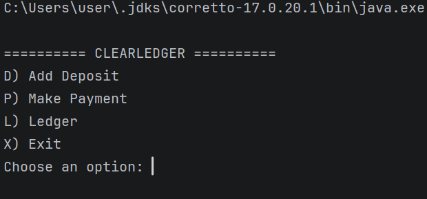
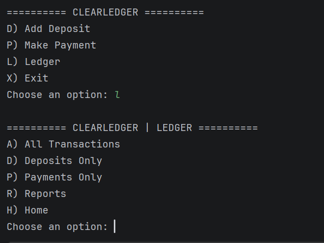
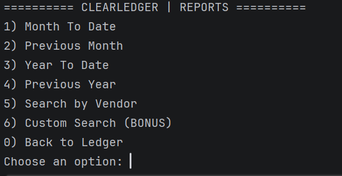
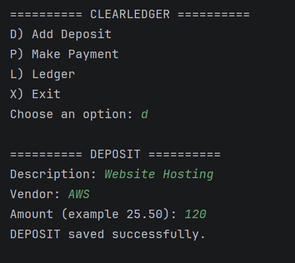

Accounting Ledger Application 

**Project Description**

A Java console-based accounting application that allows users to record deposits, track payments, view financial transactions, and generate reports.

The application uses object-oriented programming (OOP), ArrayLists, BigDecimal, and CSV file handling to manage financial records.

**Features**

Add deposits (positive transactions)

Record payments (negative transactions)

Display all transactions, newest first

View deposits and payments separately

Generate month-to-date reports

Generate previous-month reports

Generate year-to-date reports

Generate previous-year reports

Search transactions by vendor

Bonus: Custom transaction search

Input validation and exception handling

Automatically save transactions to a CSV file


**Technologies Used**

Java

IntelliJ IDEA

Git and GitHub


## 📁 Project Structure

```text
AccountingLedgerApplication/
├── src/
│   └── main/
│       └── java/
│           └── com/
│               └── pluralsight/
│                   ├── Main.java
│                   ├── Transaction.java
│                   ├── TransactionManager.java
│                   ├── LedgerManager.java
│                   └── ReportManager.java
├── screenshots/
│   ├── home-menu.png
│   ├── ledger-menu.png
│   ├── reports-menu.png
│   └── transaction-example.png
├── transactions.csv
└── README.md
```

_Main.java_ — Controls menus, user input, and application navigation.

_Transaction.java_ — Represents a transaction with its date, time, description, vendor, and amount.

_TransactionManager.java_ — Creates, saves, loads, sorts, and filters transactions.

_LedgerManager.java_ — Displays transaction records.

_ReportManager.java_ — Generates date reports and performs vendor and custom searches.

_transactions.csv_ — Stores transaction data between sessions.

**How to Run**

Clone or download the repository.

Open the project in IntelliJ IDEA.

Run Main.java.

Select an option from the Home menu.

Follow the console prompts to record or view transactions.

The program creates transactions.csv in its working directory if the file does not already exist.


### Interesting Code — Exception Handling and CSV Validation

Another important part of my project is how I used `try/catch` inside `TransactionManager.java` to handle invalid data when loading transactions from the CSV file.

**My Java Code:**

```java
try {
    LocalDate date = LocalDate.parse(parts[0]);
    LocalTime time = LocalTime.parse(parts[1]);
    String description = parts[2];
    String vendor = parts[3];
    BigDecimal amount = new BigDecimal(parts[4]);

    Transaction transaction = new Transaction(
            date, time, description, vendor, amount);

    transactions.add(transaction);

} catch (Exception e) {
    System.out.println("Skipping invalid transaction.");
}
```

**How It Works:**

- The `try` block attempts to convert CSV data into the correct Java data types.
- `LocalDate.parse()` and `LocalTime.parse()` convert the date and time.
- `new BigDecimal(parts[4])` converts the amount into a monetary value.
- The `Transaction` constructor creates a new transaction object.
- `transactions.add(transaction)` stores the object in the ArrayList.
- If the data is invalid, the `catch` block handles the exception and allows the program to continue loading other transactions.

**Why I Chose This Code:**

I chose this section because it demonstrates how exception handling makes my application more reliable.

If a CSV record contains an invalid date, time, or amount, ClearLedger skips that transaction instead of stopping the entire application.

This helped me understand how file handling, exception handling, constructors, and ArrayLists work together in Java.


## Screenshots

### Home Menu


### Ledger Menu


### Reports Menu


### Transaction Example



**What I Learned**

Through this project, I practiced object-oriented programming, class relationships, constructors, ArrayLists, file handling, exception handling, input validation, and organizing methods across multiple Java classes.

I also learned how to separate the user interface, transaction management, ledger display, and reporting responsibilities.